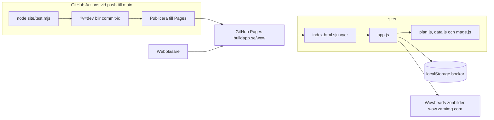

# WoW Forever-ritningen

## Syfte

Privat samlingssida för oss som börjar spela WoW: Forever (släpp 5 november 2026 kl. 00:00 svensk tid). Live på `https://buildapp.se/wow/`, med `noindex, nofollow`, utan länk från buildapp.se och utan rad i dess sitemap. Ingen inloggning: sidan är olistad, inte hemlig.

## Innehåll

Sju vyer, en i taget via länkar med `#`: Roadmap (tidslinje plus main och alts), Missa inte, Köp och sälj (tabell per nivå, tillverkning, malm, Gantt-schema, arbitrage), Mål, Karaktärer, Legacy, Addons. Text i `site/index.html`, tidslinje och handelslista i `site/plan.js`, Legacy-data och byggen i `site/data.js`.

## Gruppen

Patrik spelar Gnome Mage med Mining och Engineering, plus bank-alt med Tailoring och Enchanting (hans egna val). Sambon spelar Hunter med Skinning och Leatherworking. Övriga: Protection Warrior, Priest, Druid och en Warrior som spelar mer sällan. Altplanen utgår från det: alt 2 är Paladin eftersom den fyller den roll som saknas. Legacy räknas per konto, så andras yrken ger inte Patrik poäng.

## Regler för innehållet

Patriks beslut 2026-11-02, ersätter säkerhetsmärkningen och faktakollen i första versionen:

- Sidan säger vad man ska göra. Inga texter om vad någon källa påstått eller vad som inte gick att belägga. Det som inte går att agera på utelämnas.
- Forever är inte Classic. Inget Classic-minne utan att det är kontrollerat mot Forever.
- Tabellen per nivå (`PLAN` i `site/plan.js`) är enda källan för vad som ska göras, köpas och säljas. Typkolumnen har bara Köp, Samla, Spara och Sälj. Den sorteras inte, eftersom nivåordningen är innehållet. Den har antal, maxpris och riktpris. Priserna är startvärden byggda på betans AH, vendorvärden och Mister Graphed, och skrivs om med riktiga priser efter släppet.
- Att Mister Graphed säljer mer än Gift of Galloping kommer från tredjepartsguider, inte Wowheads databas. Hela takmodellen vilar på det, så sidan säger åt läsaren att kolla i spelet innan större köp.
- Listan över dyra föremål visar betapris och var föremålet droppar. Patrik tog bort Classic Era-kolumnen 2026-11-02: den tillförde inget. Gränsen är min egen regel. Föremål ska finnas i Wowheads Forever-databas för att komma med.
- Riktpriser utan betapris är egna uppskattningar: fire-materialen, väskorna och maxpriserna under Graphed-taket.

## Teknik

Statisk sida på GitHub Pages utan byggsteg, förutom att deployen byter `?v=dev` mot commit-id i filadresserna. JS och CSS cachas 4 h och HTML 10 min, så utan versionen möter ny HTML gammal `app.js` och sidan blir tom. Nya filer måste få `?v=dev` där de laddas. `node site/test.mjs` (också i Actions) fäller publiceringen om ett Legacy-bygge inte går att köpa enligt grindarna, om summorna inte stämmer, om ett handelspris saknar marginal eller går över Graphed-taket, om `noindex` saknas eller om tankstreck eller Gemini-text smyger sig in. Tabellsortering kopierad från `elwyn-dash/public/sortable.js`. Bockar sparas i `localStorage`, per webbläsare.

Kartan använder Wowheads zonbilder direkt från `wow.zamimg.com` (`classicplus/maps/enus/zoom/ID.jpg`), med egna nålar i procent. Slutar bilderna fungera finns koordinaterna kvar i texten. Malmrutterna är förberäknade slingor över Wowheads spawnpunkter (kortaste väg, rak linje): de tar inte hänsyn till terräng.

## Architecture

Statisk sida utan backend; detaljerna står under §Teknik ovan.

## Stack

- Frontend: statisk HTML, CSS och vanilla JS, inget ramverk och inget byggsteg
- Kod: JavaScript
- Data: `site/plan.js` och `site/data.js`, bockar i localStorage, ingen backend
- Tester: `node site/test.mjs`, fäller publiceringen i Actions
- CI: GitHub Actions testar, versionsmärker filadresserna och publicerar vid push till `main`
- Hosting: GitHub Pages, buildapp.se/wow, olistad med noindex

## Audits

- UX: 2026-11-02, warn, 5 av 6 skriptkontroller gröna, kvar är radio- och kryssrutor under 44 px vars etiketter ger målytan. Navigationens 39 px rättades efter körningen. Breda tabeller scrollar i egen ruta på mobil.
