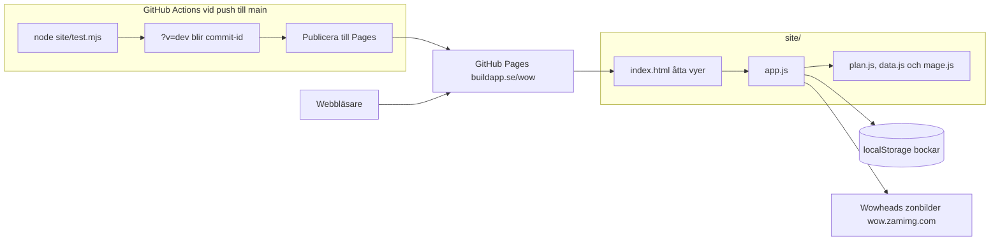

# WoW Forever-ritningen

## Syfte

Privat samlingssida för oss som börjar spela WoW: Forever (släpp 5 november 2026 kl. 00:00 svensk tid). Live på `https://buildapp.se/wow/`, med `noindex, nofollow`, utan länk från buildapp.se och utan rad i dess sitemap. Ingen inloggning: sidan är olistad, inte hemlig.

## Innehåll

Åtta vyer, en i taget via länkar med `#`: Roadmap (tidslinje plus main och alts), Missa inte, Köp och sälj (tabell per nivå, tillverkning, malm, Gantt-schema, arbitrage), Mål, Karaktärer, Dungeons, Legacy, Addons. Text i `site/index.html`, tidslinje och handelslista i `site/plan.js`, Legacy-data och byggen i `site/data.js`.

## Gruppen

Patrik spelar Gnome Mage med Mining och Engineering, plus bank-alt med Tailoring och Enchanting (hans egna val) och, från 21 november, en Warrior-alt med Blacksmithing och Alchemy (Patriks besked 26 november). Sambon spelar Hunter med Skinning och Leatherworking. Övriga: Protection Warrior, Priest, Druid och en Warrior som spelar mer sällan. Patrik har också en Rogue-alt med Skinning och Herbalism (11 november). Altplanen under Roadmap visar de fyra som finns i spelordning, sedan förslagen Paladin (fyller den roll som saknas) och Hunter. Legacy räknas per konto, så andras yrken ger inte Patrik poäng.

## Regler för innehållet

Patriks beslut 2026-11-02, ersätter säkerhetsmärkningen och faktakollen i första versionen:

- Sidan säger vad man ska göra. Inga texter om vad någon källa påstått eller vad som inte gick att belägga. Det som inte går att agera på utelämnas.
- Forever är inte Classic. Classic-uppgifter får vara med när de är relevanta och Forever saknar data, märkta "i Classic" (Patriks beslut 2026-11-05). Annars inget Classic-minne utan kontroll mot Forever.
- Tabellen per nivå (`PLAN` i `site/plan.js`) är enda källan för vad som ska göras, köpas och säljas. Typkolumnen har bara Köp, Samla, Spara och Sälj. Den sorteras inte, eftersom nivåordningen är innehållet. Den har antal, maxpris och riktpris. Riktpriset är AH-medianen på wow.gg (EU Alliance PvE) i `AH24` i `site/plan.js`, maxpriset hälften avrundat nedåt; tidslinjen läser samma tabell. Tillverkning räknas på lägsta utköp.
- Att Mister Graphed säljer mer än Gift of Galloping kommer från tredjepartsguider, inte Wowheads databas. Hela takmodellen vilar på det, så sidan säger åt läsaren att kolla i spelet innan större köp.
- Listan över dyra föremål visar AH-pris (wow.gg EU Alliance PvE 20 nov), betapris och var föremålet droppar. Gränsen är halva AH-priset, annars halva betapriset. Patrik tog bort Classic Era-kolumnen 2026-11-02: den tillförde inget. Gränsen är min egen regel. Föremål ska finnas i Wowheads Forever-databas för att komma med.
- Riktpriser utan betapris är egna uppskattningar: fire-materialen, väskorna och maxpriserna under Graphed-taket.

## Teknik

Statisk sida på GitHub Pages utan byggsteg, förutom att deployen byter `?v=dev` mot commit-id i filadresserna. JS och CSS cachas 4 h och HTML 10 min, så utan versionen möter ny HTML gammal `app.js` och sidan blir tom. Nya filer måste få `?v=dev` där de laddas, och nya moduler en `modulepreload`-rad i `index.html` med samma adress. `node site/test.mjs` (också i Actions) fäller publiceringen om ett Legacy-bygge inte går att köpa enligt grindarna, om summorna inte stämmer, om ett handelspris saknar marginal eller går över Graphed-taket, om `noindex` saknas eller om tankstreck eller Gemini-text smyger sig in. `site/404.html` ersätter GitHub Pages engelska 404 under /wow/ (absoluta adresser, eftersom den visas på alla saknade sökvägar). Tabellsortering kopierad från `elwyn-dash/public/sortable.js`. Bockar sparas i `localStorage`, per webbläsare, med nyckel efter radens text utan priser och siffror (`bockId` i `site/plan.js`): ändrad formulering tappar bocken, nya priser och nya rader gör det inte. Laddar inte modulerna visar `stil.css` en ruta om att ladda om efter 6 s. Typsnitten (Barlow, Barlow Condensed, latin) ligger i `site/fonts/` och laddas från `stil.css`, utan preload: preload gjorde FCP 200 ms sämre på Slow 4G.

Kartan använder Wowheads zonbilder direkt från `wow.zamimg.com` (`classicplus/maps/enus/zoom/ID.jpg`), med egna nålar i procent. Slutar bilderna fungera finns koordinaterna kvar i texten. Malmrutterna är förberäknade slingor över Wowheads spawnpunkter (kortaste väg, rak linje): de tar inte hänsyn till terräng.

## Architecture

Statisk sida utan backend; detaljerna står under §Teknik ovan.

## Stack

- Frontend: statisk HTML, CSS och vanilla JS, inget ramverk och inget byggsteg
- Kod: JavaScript
- Data: `site/plan.js` och `site/data.js`, bockar i localStorage, ingen backend
- Tester: `node site/test.mjs`, fäller publiceringen i Actions
- CI: GitHub Actions testar, versionsmärker filadresserna och publicerar vid push till `main`
- Hosting: GitHub Pages, buildapp.se/wow, olistad med noindex

## Audits

- UX: 2026-11-24, warn, 5 av 7 skriptkontroller gröna (2026-11-02: 5 av 6). Kvar: menyn har 8 vyer (Hick, över 7) och platsknapparna i bockraderna är 32 px (`.bock .plats` i stil.css, avståndet klarar WCAG 2.5.8). Kryssrutornas 22 px täcks av etiketten på 44 px. Ingen horisontell scroll i 390 och 1440 px.
- Mutation: 2026-11-24, pass, Stryker 99,59 % på 242 mutanter (2026-11-04: 100 % på 97): site/data.js 100 %, site/plan.js 100 %, site/sortable.js 99,3 % (ej mätt förut, inga tester). Enda överlevande är `* direction` mot `/ direction` i compareValues, likvärdig när riktningen är 1 eller -1.
- Fart och tillgänglighet: 2026-11-25, pass, live med Playwright i alla åtta vyer, 390 px (4x CPU, Slow 4G) och 1440 px. axe-core 0 fel i alla 16 (före: 1 per vy, h1 saknades och rubriknivå hoppade). CLS Roadmap 390 px 0,23 till 0,003; Missa inte, Köp och sälj och Mål 0,08 till 0,11 kvar av typsnittsbytet (BACKLOG). LCP 390 px 0,94 till 1,44 s, 1440 px 0,12 till 0,40 s, 179 till 224 KB överfört, inga bilder i första vyn. Render-blockerande: bara `stil.css` (före även Google Fonts-CSS:en).
- Preferenser: 2026-11-25, pass med en P3 kvar, headless Playwright lokalt i alla åtta vyer och 404-sidan. Sidan är bara mörk (`color-scheme: dark`), ingen ljus variant. Reducerad rörelse: mjuk scroll av, inga animationer. 200 % text i 1280 och 390 px och tvingade färger rättade (BACKLOG); kvar: yrkesmatrisen i Legacy, Gantt-axeln i 390 px och två kartnålar vid 200 %.
- OWASP Top 10: 2026-11-24, pass, code review (Gemini 4 Neon High, findings checked by Claude), no live probe; 0 high, 0 medium open
